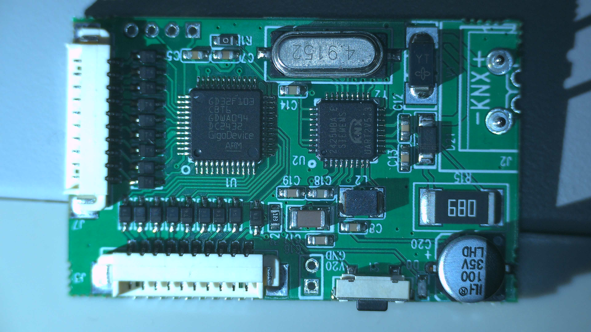
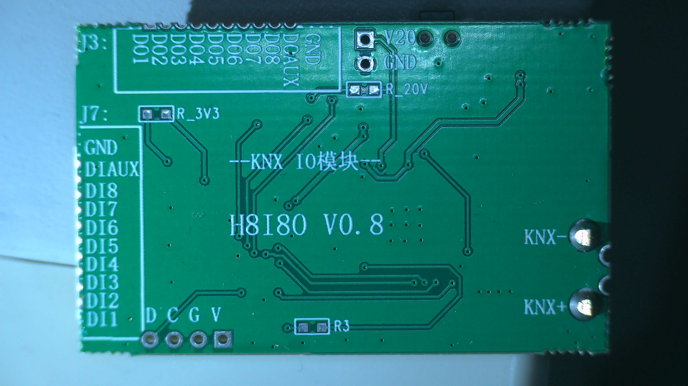

# Hardware: the H8i8o V0.8 board

The H8i8o (silkscreen `H8I8O V0.8`, `KNX IO模块`) is a bus-powered KNX TP1 module with eight
digital inputs and eight digital outputs, brought out on two connectors to a separate I/O
board.

| Component side | Solder side |
|---|---|
|  |  |

## Main parts

| Part | Detail |
|---|---|
| MCU (U1) | GigaDevice GD32F103CBT6: Cortex-M3, 128 KiB flash (1 KiB pages), 20 KiB RAM, no crystal of its own |
| KNX transceiver (U2) | Siemens TP-UART2 (marked `KNX UART2V5.3`), with its 4.9152 MHz crystal |
| Power | From the KNX bus through the TP-UART2's supply: 680 Ω resistor, inductor, 100 µF / 35 V reservoir. The logic rail measures about 3.23 V |
| Connectors | J7: GND, DIAUX, DI8 … DI1. J3: GND, AUX, DO8 … DO1 |
| Debug | `D C G V` pads: SWDIO, SWCLK, GND, 3.3 V |
| Other | `V20` / `GND` pads (the TP-UART2's 20 V auxiliary rail), slide switch S1, option links `R_3V3`, `R_20V`, `R3` |

## Pin map

"Measured" means checked on a V0.8 board with this firmware. "As DI1/DO1" means the channel
is wired like the measured one according to the community pin map, but was not measured
separately.

| Function | Pin | Configuration | Status |
|---|---|---|---|
| SWDIO / SWCLK | PA13 / PA14 | SWD; JTAG released (`AFIO_PCF0.SWJ_CFG = 010`) | Measured |
| TP-UART2 host link TX / RX | PA9 / PA10 (USART1) | 19200 baud, 8 data bits, even parity, 1 stop bit | Measured |
| Programming button | PA11 | Input, internal pull-up; active low | Measured |
| KNX LED | PA12 | Push-pull output; active high | Measured |
| DI1 | PA15 | Input, internal pull-up; active low (contact to GND) | Measured |
| DI2–DI8 | PB3–PB9 | As DI1 | As DI1 |
| DO1 | PA0 | Push-pull output; active high, 0 V when off and after reset, 3.3 V when on (no load) | Measured |
| DO2–DO8 | PA1–PA7 | As DO1 | As DO1 |
| DIAUX | PC13 | Not used (left as a floating input) | — |
| AUX | PB0 | Not used (left as a floating input) | — |

PA15, PB3 and PB4 (DI1–DI3) are JTAG pins after reset. The firmware releases JTAG and keeps
SWD. Never set `SWJ_CFG` to `100`: that disables SWD as well, and the board has no other
way in.

Not known: whether the TP-UART2's `RESET` and `SAVE` pins reach the MCU, the function of the
slide switch and the option links, and the electrical ratings of the input and output stages
(the rows of SOT-23 parts between the MCU and the connectors). The firmware does not depend
on any of them. Check the I/O board before connecting loads.

## Debug header and power

| Pad | Signal | Notes |
|---|---|---|
| D | SWDIO (PA13) | |
| C | SWCLK (PA14) | |
| G | GND | Probably tied to the bus circuit |
| V | 3.3 V | Leave unconnected while the board is on the bus |

- Power the board from the KNX bus while programming it. Do not feed 3.3 V into `V` at the
  same time: on our board that pulled about 250 mA, the rail sagged and the MCU stopped
  answering.
- Before joining the grounds, check that the DC voltage between `G` and the probe's ground
  is about 0 V. An isolated probe, or a laptop on battery, avoids ground loops.
- Never connect anything to `V20`: it is the TP-UART2's auxiliary supply, not a logic rail.
- There is no reset line on the header. OpenOCD runs with `reset_config none` and resets
  the core through the debug port.

## First-time access

Boards come with read-protected flash (`FLASH_OBR` read `0x03fffffe` on ours). Removing the
protection mass-erases the chip, so **the factory firmware is lost** and cannot be read back
or restored. The README gives the procedure.

After that the chip has 128 KiB of flash and no write protection. The debug IDs read from
our board: DPIDR `0x1ba01477`, CPUID `0x412fc231` (Cortex-M3 r2p1), DBGMCU_IDCODE
`0x13030410`. OpenOCD drives it with the `stm32f1x` target and `set CPUTAPID 0`.

## Observed behaviour of the parts

**TP-UART2.**

- `U_Reset.req` is answered with `U_Reset.ind` after 6.9 ms, preceded by one octet with a
  framing error while the chip resets.
- `U_State.req` is answered with `07` (no error flags) after about 1.4 ms.
- `U_ProductID.req` is answered with `41`.
- `U_SetAddress` is `28h` followed by the address (the TP-UART2 manual's `F1h` is not
  accepted by this chip).
- The chip echoes the frames the device sends before the `L_Data.con`.
- Once it has an individual address, the chip acknowledges every group telegram on the line
  by itself, as most KNX devices do.

**GD32F103 flash.** Measured with the core at 8 MHz:

- A 1 KiB page erase takes 37–39 ms; programming a half-word takes about 100 µs.
- The CPU cannot fetch from flash during an erase. An interrupt taken while code runs from
  flash during an erase **locks the chip** (core and debug port) until a reset. The firmware
  avoids this: [firmware.md](firmware.md#flash-erases-and-the-bus).
- Debug-port reads that land during an erase fail, so an RTT session can drop while the
  device writes its configuration.

**Debug access while idle.** The core sleeps in `WFI` between interrupts, which stops the
clock the debug port needs. The firmware keeps the debug clocks on in sleep (`DBGMCU_CR`), so
the probe can attach at any time.

## References

- GigaDevice, GD32F103xx datasheet and GD32F10x user manual.
- Siemens, KNX EIB TP-UART 2-IC technical data (A6V11933793) and technical manual.
- [thelsing/knx](https://github.com/thelsing/knx), whose H8I8O support (commit 8b9ff4f) first
  published the pin map.
- [pavkriz/hacking-knx-h8i8o](https://github.com/pavkriz/hacking-knx-h8i8o): the original
  write-up on opening this board.
